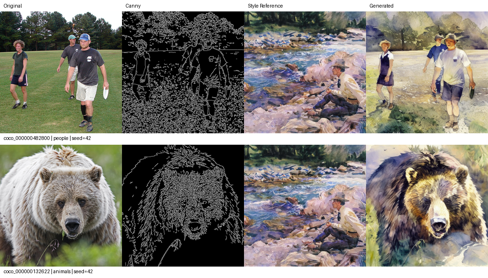

# Диффузионные методы переноса стиля

Учебный проект: сравнение стилевой LoRA и IP-Adapter при сохранении композиции через ControlNet Canny. На первом этапе выполнен baseline **Stable Diffusion 1.5 + ControlNet + IP-Adapter**. Обучение LoRA и сравнение параметров запланированы на второй этап.

[Отчёт PDF](docs/stage1_report.pdf) · [Текст отчёта и анализ](docs/stage1_report.md) · [Colab](https://colab.research.google.com/github/Batyaoftheyear/diffusion-style/blob/main/colab_stage1.ipynb)

## Результаты этапа 1

Прогон `c66b0a9fe8ce4d583cfd` выполнен на Tesla T4. Подготовлены 75 картин импрессионизма (70 для будущей LoRA и 5 референсов) и 24 фотографии COCO validation 2017. Для всех генераций использован один фиксированный референс `wikiart_00000798`.

Получено **23 изображения**, один случай (`coco_000000423971`) пропущен после срабатывания safety checker. Средние и выборочные стандартные отклонения ниже рассчитаны по 23 успешным результатам при seed 42.

| Показатель | Среднее ± SD |
|---|---|
| Edge precision | 0.755 ± 0.218 |
| Edge recall | 0.846 ± 0.085 |
| Edge F1 | 0.772 ± 0.149 |
| DINOv2 cosine | 0.482 ± 0.224 |
| Время генерации, с | 13.486 ± 7.698 |
| Пик allocated, МиБ | 3186.285 ± 2.420 |

Контуры помогают сохранить основные силуэты и расположение объектов, но лица, одежда и предметные детали могут меняться. На первых шести сценах заметны перенос палитры и живописной фактуры, а также изменение фона и содержимого отдельных сцен. Подробный разбор — в разделе 4.1 отчёта. Edge F1 и DINO оценивают разные свойства; эти показатели нельзя напрямую сопоставлять между собой или считать оценкой качества стиля.



[Первые шесть сцен](docs/figures/comparisons.png) · [Метрики по фотографиям](docs/baseline/metrics.csv) · [Сводка и протокол](docs/baseline/summary.json) · [Параметры прогона](docs/baseline/run.json)

## Пайплайн и настройки

Исходное фото → Canny → ControlNet; художественный референс → CLIP vision → IP-Adapter; описание фото → CLIP text. Условия поступают в SD 1.5 / UNet, который преобразует сохранённый начальный шум; VAE декодирует результат. Исходная фотография не используется как img2img-латент.

| Параметр | Значение |
|---|---|
| Разрешение | 512 × 512 |
| Scheduler / шаги / eta | DDIM / 30 / 0 |
| CFG | 7.5 |
| ControlNet / IP-Adapter | 1.0 / 0.6 |
| Canny | 100 / 200 |
| Seed | 42 |
| Точность / память | FP16 / CPU offload |

Полные revisions моделей и наборов данных закреплены в [configs/baseline.yaml](configs/baseline.yaml). Это исходная конфигурация для будущих экспериментов, её оптимальность не предполагается.

## Запуск в Colab

1. Открыть [colab_stage1.ipynb](https://colab.research.google.com/github/Batyaoftheyear/diffusion-style/blob/main/colab_stage1.ipynb) и выбрать T4 GPU.
2. Подключить Google Drive, получить код и установить зависимости в отдельное окружение.
3. Выполнить тесты, подготовку данных и просмотр примеров.
4. Запустить проверку на двух фото, затем основной baseline и расчёт метрик.

Целевая среда: Linux / Colab, Python 3.11–3.13, PyTorch 2.8.0 + CUDA 12.6. Версии закреплены в `requirements.txt`. Ноутбук использует автономный virtualenv с проверкой SHA-256, не заменяя пакеты системного Python. Скрипты выполняются отдельными процессами; перед расчётом DINO генерационные модели освобождают память.

Данные, веса и результаты сохраняются в `MyDrive/diffusion_style_transfer/`. После сброса Colab необходимо восстановить окружение и подключить тот же Drive. Подготовленные данные и результаты переиспользуются после проверки целостности. При изменении конфигурации, входов, генерационного кода или окружения создаётся отдельный прогон.

## Команды

Из корня проекта в подготовленном окружении:

```bash
python -m unittest discover -s tests -v
python scripts/prepare_data.py --config configs/baseline.yaml
python scripts/prepare_data.py --config configs/baseline.yaml --check-only
python scripts/run_baseline.py --config configs/baseline.yaml --limit 2
python scripts/run_baseline.py --config configs/baseline.yaml
python scripts/evaluate.py --config configs/baseline.yaml
```

Для явного завершения после известного срабатывания постфильтра, если все остальные результаты уже сохранены:

```bash
python scripts/finalize_run.py --skip-photo coco_000000423971 --reason safety_checker
python scripts/evaluate.py
```

Команда проверяет существующие PNG и latents, сохраняет причину пропуска в том же `run_id` и не подменяет неудачный результат другим фото. `completed_images`, `skipped_images` и `processed_complete` учитываются отдельно. Чёрные изображения постфильтра не входят в метрики; safety checker остаётся включённым. При дальнейшем сравнении нужны общие пары фото/seed и отдельный учёт доли неуспехов.

Для отдельного GPU-теста: `RUN_GPU_SMOKE=1 python -m unittest discover -s tests -p test_gpu_smoke.py -v` в Linux. По умолчанию этот тест пропускается.

## Данные, метрики и воспроизводимость

WikiArt: [huggan/wikiart](https://huggingface.co/datasets/huggan/wikiart), импрессионизм, детерминированный отбор по seed и ID, удаление точных и близких дубликатов до разбиения. Пять референсов не пересекаются с будущей обучающей выборкой. COCO: [validation 2017](https://huggingface.co/datasets/phiyodr/coco2017), по четыре фото на шесть тематических групп по captions. Промпт — исходная аннотация с минимальным ID. Загружаются выбранные изображения, а не полные наборы.

Преобразования: EXIF → RGB → центральный crop/resize с сохранением пропорций → 512 × 512; для фотографий дополнительно Canny. Сохраняются исходники, captions, IDs, URL, разбиения, контрольные суммы, изображения и фактические FP32 latents. Центральная обрезка может удалить важные объекты.

Композиция оценивается через Canny precision/recall/F1 с допуском 2 пикселя; содержание — cosine similarity нормированных CLS-признаков DINOv2. Стиль оценивается визуально по палитре, мазкам и фактуре. Среднее и SD при одном seed отражают различия между фотографиями, а не устойчивость к шуму.

Основные артефакты в Drive:

```text
data/<data_id>/                 # исходники, prepared, Canny, manifests, captions
results/<run_id>/
  images/ latents/ metadata/
  run.json parameters.json
  results.csv results.jsonl
  coverage.csv skipped.csv
  figures/comparisons.png
  evaluation/<evaluation_id>/
  metrics.csv summary.json
results/current_run.json
.cache/huggingface/
```

В репозитории находятся код, отчёт, сравнительные иллюстрации и небольшие таблицы завершённого baseline. Полные датасеты, веса и кэши в Git не включаются.

## Структура проекта

| Путь | Содержание |
|---|---|
| `src/data.py`, `src/preprocessing.py` | Загрузка, отбор и преобразования данных |
| `src/pipeline.py`, `src/inference.py` | Модели, latents, генерация и продолжение прогона |
| `src/run_status.py` | Учёт явных пропусков |
| `src/metrics.py`, `src/visualization.py` | Метрики и сравнительные таблицы |
| `src/config.py`, `src/io.py`, `src/bootstrap.py` | Конфигурация, артефакты и окружение |
| `scripts/` | Независимые команды подготовки, генерации и оценки |
| `tests/` | Проверки данных, метрик, latents и продолжения |
| `docs/` | Отчёт, теория, методология, результаты и план этапа 2 |

## Источники и дальнейшая работа

SD 1.5 и ControlNet имеют условия OpenRAIL; IP-Adapter и выбранная конверсия DINOv2 — Apache-2.0 по карточкам моделей. Карточка WikiArt ограничивает использование некоммерческими исследованиями; права на отдельные изображения сохраняются у правообладателей. У COCO сохраняются индивидуальные `license_id` и ссылки. Подробности и первичные источники — в [методологии](docs/methodology.md) и [теории](docs/theory.md).

На втором этапе планируется обучить LoRA с рангами 4, 8 и 16, исследовать статические веса и расписания коэффициентов, затем выполнить парное сравнение на нескольких seed. [План экспериментов](docs/stage2_plan.md).
