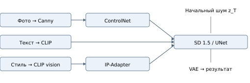
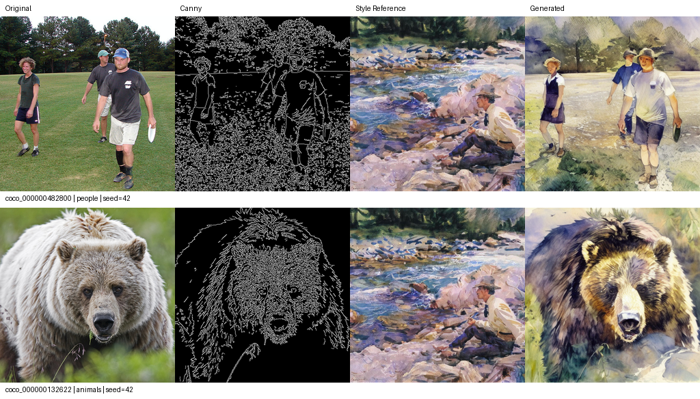

# Диффузионные методы переноса стиля
Промежуточный отчёт. Этап 1: подготовка данных, воспроизводимый baseline и протокол будущего сравнения.

## 1. Задача и данные
Цель проекта — сравнить передачу художественного стиля через изображение-референс IP-Adapter и через обученную стилевую LoRA. В обеих ветвях композицию задаёт один ControlNet Canny. На первом этапе реализуется только IP-Adapter; обучение и сравнительные эксперименты запланированы на второй этап [1–4]. Целевая среда — Colab T4 с 16 ГБ VRAM; выбраны SD 1.5, FP16 и CPU offload. SDXL не используется, чтобы ограничить расход памяти и вычислительный бюджет.

Подготовлены 75 картин: 70 для будущего обучения и 5 отдельных референсов; 24 фотографии COCO.

WikiArt: импрессионизм из huggan/wikiart. Из первых 1500 строк отбираются кандидаты нужного класса и упорядочиваются хешем seed и ID. После проверки RGB-изображений и удаления точных и близких dHash-дубликатов первые пять изображений выделяются в референсы; первое задаёт baseline. Остальные предназначены для будущей LoRA. COCO: 24 фотографии validation 2017, по четыре на шесть тематических групп по ключевым словам в captions. Промпт берётся из аннотации с минимальным ID. Такой отбор воспроизводим, но не представляет случайную выборку всего COCO [8, 9].

Размер приводится к 512 × 512 через центральный crop без изменения пропорций. Сохраняются исходники, преобразованные файлы, Canny, captions, IDs, источники, разбиения и SHA-256. Captions картин построены по жанровой метке и требуют просмотра перед будущим обучением.

## 2. Модели и исходные настройки
Использованы репозитории stable-diffusion-v1-5/stable-diffusion-v1-5, lllyasviel/control_v11p_sd15_canny и h94/IP-Adapter. Веса адаптера — models/ip-adapter_sd15.safetensors; CLIP vision encoder — models/image_encoder. Полные revisions закреплены в YAML и метаданных прогона [6, 7].

| Параметр | Значение |
|---|---|
| Разрешение / шаги | 512 × 512 / 30 |
| Scheduler / seed / eta | DDIM / 42 / 0.0 |
| CFG / ControlNet / IP-Adapter | 7.5 / 1.0 / 0.6 |
| Canny / точность | 100, 200 / float16 |
| Экономия VRAM | CPU offload |

SD и ControlNet имеют условия CreativeML OpenRAIL-M; IP-Adapter и выбранная конверсия DINOv2 — Apache-2.0. Карточка WikiArt ограничивает использование некоммерческими исследованиями; права на отдельные работы остаются у правообладателей. Для фотографий COCO сохраняются индивидуальные license_id и ссылки, единая свободная лицензия изображениям не приписывается [6–9].

<!-- PAGE -->
# 3. Методы и общий пайплайн

Рис. 1. Пайплайн baseline. При будущем сравнении IP-Adapter заменяется на LoRA в UNet; ControlNet и остальные условия сохраняются.

**Latent Diffusion.** SD работает с латентным представлением изображения: VAE переводит между пикселями и латентами, UNet предсказывает шум на очередном шаге, CLIP text encoder задаёт текстовое условие. Scheduler определяет последовательность шумовых уровней и обновление латента. В text-to-image начальное состояние — шум z_T; исходная фотография не кодируется в стартовый латент и img2img не применяется [1, 6].

**ControlNet.** Дополнительная обученная сеть передаёт пространственные признаки в блоки замороженного UNet. В работе условием служат границы Canny исходного фото. Они задают расположение силуэтов и деталей, но не фиксируют цвет, идентичность объектов и всю семантику. Canny не гарантирует точного сохранения содержания; мелкие контуры могут конфликтовать с художественной фактурой [2].

**IP-Adapter.** CLIP vision encoder извлекает признаки референса. Отдельная ветвь cross-attention передаёт их UNet параллельно текстовому условию. Вес IP-Adapter управляет силой этой ветви. Адаптер не требует обучения на нашей коллекции, однако может передавать объекты и композиционные признаки картины вместе с палитрой и фактурой. Обычный IP-Adapter не является механизмом исключительно стилевого conditioning [3, 7].

**LoRA.** Для замороженной матрицы W размера d_out × d_in обновление записывается как W_eff = W + s · (α/r) · BA, где B имеет размер d_out × r, A — r × d_in. Обучается r(d_in + d_out) параметров вместо d_out · d_in. Ранг r ограничивает выразительность адаптации; большой ранг увеличивает ёмкость и риск переобучения. Training alpha α нормирует обновление при обучении, inference scale s управляет применением уже обученных весов. Их нельзя считать одним гиперпараметром [4, 6].

**Коэффициенты по шагам.** В будущем s или вес IP-Adapter можно задавать функцией номера шага k: constant, linear increase или linear decay. При одинаковой средней силе разные расписания распределяют влияние между ранней структурой и поздней детализацией. Это проверяемая гипотеза, а не установленное преимущество. Реализация должна будет задать вес до первого шага и учитывать, что callback конца шага влияет на следующий шаг. На первом этапе используется только постоянный вес [6].

<!-- PAGE -->
# 4. Воспроизведение baseline

Прогон c66b0a9fe8ce4d583cfd выполнен на Tesla T4. Получено 23 изображения из 24. Для coco_000000423971 сработал safety checker; этот случай отмечен как пропуск и исключён из метрик.

Сначала выполняется smoke test на двух фотографиях, затем основной запуск на всех 24. Успешные результаты smoke test переиспользуются в том же прогоне. На каждой фотографии используется seed 42 и отдельный CPU-generator: создаётся тензор N(0,1) формы 1 × 4 × 64 × 64 в FP32, сохраняется в NPY и передаётся пайплайну после приведения к FP16. Один и тот же шум можно повторно использовать при будущем сравнении. DDIM работает с eta = 0.

| Показатель | Среднее ± SD | n |
|---|---|---|
| Edge precision | 0.755 ± 0.218 | 23 |
| Edge recall | 0.846 ± 0.085 | 23 |
| Edge F1 | 0.772 ± 0.149 | 23 |
| DINOv2 cosine | 0.482 ± 0.224 | 23 |
| Время, с | 13.486 ± 7.698 | 23 |
| Пик allocated, МиБ | 3186.285 ± 2.420 | 23 |

Рис. 2. Первые два примера фиксированного отбора: исходное фото, Canny, референс, результат. Полная таблица первых шести сцен сохранена в figures/comparisons.png; примеры не отбирались по значениям метрик.

<!-- PAGE -->
## 4.1. Анализ результатов

**Композиция.** Средний Edge F1 составил 0.772 ± 0.149. На первых шести сценах сохраняются расположение фигур людей, силуэт медведя, окна и часы на фасаде, линия заснеженного склона. Recall (0.846) выше precision (0.755): значительная часть исходных границ воспроизводится, но в результате возникают дополнительные контуры. Их источником могут быть как художественные штрихи, так и новые детали сцены; одна эта метрика не различает причины.

**Содержание.** DINO cosine равен 0.482 ± 0.224, с заметным разбросом между фотографиями. У медведя coco_000000132622 он составляет 0.796, у людей coco_000000482800 — 0.346. В первом случае сохраняются крупный план и узнаваемая форма головы. Во втором — общая расстановка трёх фигур, но меняются лица, головные уборы, цвета и детали одежды. Числа Edge F1 и DINO измеряют разные свойства и не сравниваются напрямую.

**Стиль и ошибки.** В просмотренных примерах появляются широкие цветовые пятна, мазки и сочетания синих, охристых и зелёных оттенков, сходные с референсом. Стилевая передача сопровождается изменением предметного содержания: в сцене с сэндвичем и чашкой фон превращается в пейзаж, заметно меняется вид еды; в сцене с собакой у духовки возникают новые предметные детали. Для этих двух случаев DINO равен 0.334 и 0.139 соответственно. Следовательно, сохранённые границы сами по себе не обеспечивают сохранение всех объектов и их свойств.

**Ресурсы и ограничения.** Среднее время вызова пайплайна — 13.49 с, средний пик allocated — около 3.11 ГиБ при CPU offload. Два первых вызова в отдельных процессах занимали 36–39 с, поэтому среднее включает прогрев. Успешно получено 23/24 изображения; причина срабатывания постфильтра на оставшемся примере отдельно не установлена. Его исключение может смещать средние показатели.

Baseline воспроизведён при фиксированных настройках. Следующая задача — проверить, можно ли уменьшить изменение содержания через вес стилевого условия и обученную LoRA. По одному референсу и одному seed вывод о преимуществе метода или оптимальности параметров сделать нельзя. Визуальные наблюдения относятся к первым шести заранее выбранным сценам; количественные показатели — ко всем 23 успешным результатам.

Генерации хранятся в PNG; параметры, scheduler config, revisions, сведения об окружении, время и память — в JSON/JSONL и CSV. Ключ прогона учитывает конфигурацию, manifests, генерационный код и окружение. Resume проверяет SHA-256 PNG и latents. CUDA синхронизируется до и после измерения времени; загрузка моделей учитывается отдельно. Первая генерация может включать разовый прогрев. Перенос на другой GPU или другую версию PyTorch не гарантирует побитового совпадения [10].

<!-- PAGE -->
# 5. Метрики и план экспериментов

**Композиция.** Canny вычисляется с одинаковыми порогами для исходного и полученного изображений. Допуск — 2 пикселя по расстоянию Чебышёва. Precision — доля контурных пикселей результата, попавших в расширение исходных контуров; recall — доля исходных контурных пикселей в расширении контуров результата. F1 = 2PR/(P + R). Это many-to-many matching, а не взаимно однозначное соответствие. При пустых картах соответствующий показатель принимается равным нулю. Художественные штрихи могут снижать precision без потери основной композиции.

**Содержание и стиль.** Для facebook/dinov2-base берётся CLS-токен last_hidden_state, выполняется L2-нормализация и вычисляется cosine similarity. Используются одна revision и один сохранённый image processor с use_fast=False [5]. Это приближённая семантическая близость. Стиль оценивается визуально по палитре, фактуре и характеру мазков. Искусственный style score и FID на 24 изображениях не используются.

Исходная выборка — 24 фотографии при одном seed. Фактически оценено 23 изображения; один пропуск учтён отдельно. Пропуски из-за постфильтра отмечаются отдельно и не заменяются другими фото или чёрными изображениями. Среднее и выборочное SD (ddof = 1) характеризуют различия между фотографиями, а не устойчивость к шуму. Пиковая память включает загруженные GPU-компоненты и временные тензоры; allocated и reserved сохраняются раздельно.

| Фактор этапа 2 | Значения | Проверяемая гипотеза |
|---|---|---|
| Ранг LoRA | 4, 8, 16 | Рост ёмкости может дать насыщенный стиль, затем плато или переобучение |
| Вес LoRA | 0.5, 0.8, 1.0 | Усиление стиля может ухудшить сохранение содержания |
| Вес IP-Adapter | 0.3, 0.6, 0.9 | Усиление референса может перенести лишние объекты |
| Расписание | constant, increase, decay | Момент применения условия меняет баланс структуры и стиля |

План: pilot — 6 фото × 1 seed; финальное сравнение — 24 фото × 3 seed. Фиксируются SD, ControlNet, Canny, промпты, negative prompts, scheduler, CFG, шаги, разрешение и начальные latents. Варьируется один фактор. LoRA и IP-Adapter применяются в отдельных пайплайнах; доступный им объём стилевой информации различается.

**Будущее обучение LoRA.** Только адаптеры UNet; базовые UNet, VAE и text encoder заморожены. Старт: rank 8, batch size 1, accumulation 4 (эффективный batch 4), FP16, gradient checkpointing, LR 1e-4 и 1000 optimizer steps. Это предварительный бюджет. Чекпоинты и состояние optimizer позволят продолжать обучение. Ранги сравниваются на одних данных при одинаковом числе optimizer steps и постоянном α/r. ControlNet и IP-Adapter не участвуют в обучении.

<!-- PAGE -->
# 6. План второго этапа и ограничения

1. Просмотреть художественную выборку и captions, при необходимости уточнить однородность стиля до фиксации обучающего набора.
2. Проверить короткое обучение rank 8 и восстановление checkpoint на T4; затем обучить ранги 4, 8 и 16 при одном бюджете.
3. На pilot-выборке исследовать статические веса, затем расписания с сопоставимой средней силой; записывать фактические значения по шагам.
4. Выполнить парное сравнение на 24 фото и seeds 42, 123, 777 с сохранёнными latents. Для каждого условия усреднять seeds внутри фотографии, затем фотографии.
5. Провести слепую экспертную оценку палитры/фактуры, содержания и композиции по шкале 1–5. Показывать одинаковые референсы, перемешивать методы; сохранять индивидуальные оценки и согласованность экспертов.
6. Сопоставить автоматические метрики с визуальными наблюдениями и сформулировать выводы по реальным данным. Превосходство какого-либо метода заранее не предполагается.

Основные риски: неоднородный импрессионизм, перенос содержания референса, переобучение LoRA, обрезка важных объектов центральным crop, лимиты VRAM и времени Colab, изменение API источников, ограниченная информативность Edge F1 и DINO. Рост LR или числа шагов может ускорить адаптацию и одновременно увеличить переобучение; параметры уточняются по отложенному визуальному контролю, без подбора по финальному тесту.

Увеличение ранга при постоянном числе шагов уравнивает бюджет обновлений optimizer, но не вычислительные затраты и число параметров. Один фиксированный референс также не представляет весь художественный стиль. Для итогового сравнения требуется отдельно учитывать неуспешные генерации и использовать общие пары фото и seed.

## Источники
[1] Rombach et al. High-Resolution Image Synthesis with Latent Diffusion Models. [CVPR 2022](https://arxiv.org/abs/2112.10752).

[2] Zhang et al. Adding Conditional Control to Text-to-Image Diffusion Models. [ICCV 2023](https://arxiv.org/abs/2302.05543).

[3] Ye et al. IP-Adapter: Text Compatible Image Prompt Adapter. [2023](https://arxiv.org/abs/2308.06721).

[4] Hu et al. LoRA: Low-Rank Adaptation of Large Language Models. [2021](https://arxiv.org/abs/2106.09685).

[5] Oquab et al. DINOv2: Learning Robust Visual Features without Supervision. [2023](https://arxiv.org/abs/2304.07193).

[6] [Diffusers: ControlNet](https://huggingface.co/docs/diffusers/api/pipelines/controlnet), [LoRA](https://huggingface.co/docs/diffusers/training/lora); карточки моделей и revisions — в configs/baseline.yaml и docs/methodology.md.

[7] [IP-Adapter: официальные веса](https://huggingface.co/h94/IP-Adapter), [документация](https://huggingface.co/docs/diffusers/using-diffusers/ip_adapter).

[8] [WikiArt: карточка набора](https://huggingface.co/datasets/huggan/wikiart).

[9] [COCO: условия](https://cocodataset.org/#termsofuse), [зеркало аннотаций](https://huggingface.co/datasets/phiyodr/coco2017).

[10] [PyTorch: воспроизводимость](https://docs.pytorch.org/docs/stable/notes/randomness.html).
