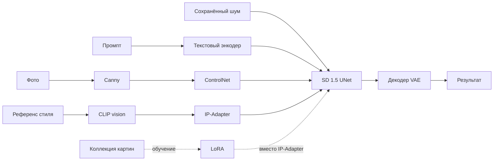

# Теоретическая база

## Stable Diffusion и начальный шум

[Latent Diffusion](https://arxiv.org/abs/2112.10752) выполняет диффузионный процесс в пространстве латентных признаков VAE. Для SD 1.5 изображению 512 × 512 соответствует тензор с четырьмя каналами и размером 64 × 64. При обучении UNet предсказывает шум, добавленный к латентному представлению. При генерации модель начинает со случайного шума и постепенно преобразует его в изображение.

Текстовый энкодер CLIP кодирует промпт, а механизм cross-attention передаёт его признаки в UNet. Планировщик (scheduler) задаёт уровни шума и правило обновления латентов. Декодер VAE переводит итоговый латент в RGB-изображение. Classifier-free guidance усиливает влияние текстового условия; в baseline используется CFG 7.5.

Исходная фотография задаёт композицию через Canny-карту и описывается аннотацией COCO в текстовом промпте. Генерация начинается со случайного шума, как в text-to-image. В отличие от img2img, фотография не кодируется в начальный латент.

DDIM с eta = 0 не добавляет случайный шум при обновлении латентов. Начальный тензор N(0,1) сохраняется до умножения на `init_noise_sigma`, чтобы затем использовать его в сравнении LoRA и IP-Adapter. Для воспроизведения шума фиксируются seed, устройство генератора, форма и тип тензора, версии библиотек. [Ограничения воспроизводимости PyTorch](https://docs.pytorch.org/docs/stable/notes/randomness.html) следует учитывать при переносе запуска на другую платформу или GPU.

## ControlNet и Canny

[ControlNet](https://arxiv.org/abs/2302.05543) передаёт пространственное условие в замороженную диффузионную модель. Дополнительная сеть обрабатывает карту условия и передаёт признаки в блоки UNet. При обучении ControlNet свёртки с нулевой инициализацией позволяют постепенно включать это условие в работу модели. В проекте используются готовые веса ControlNet Canny для SD 1.5.

Фотография переводится в RGB, обрезается по центру и приводится к 512 × 512. Затем строится карта границ: grayscale → `cv2.Canny(100, 200, apertureSize=3, L2gradient=False)`. Одноканальная карта копируется в три канала для подачи в пайплайн.

Пороги Canny определяют, какие границы попадут на карту. Коэффициент ControlNet задаёт силу её влияния на генерацию. Силуэты, границы предметов и перспективные линии помогают сохранить композицию, но карта не содержит цвета и семантических признаков. Поэтому сходство контуров оценивается отдельно от сходства содержания по DINOv2.

## IP-Adapter

[IP-Adapter](https://arxiv.org/abs/2308.06721) позволяет использовать изображение как дополнительное условие генерации. Визуальный энкодер CLIP извлекает признаки референса, а проекционный слой преобразует их в токены изображения. Отдельная ветвь cross-attention передаёт эти токены в UNet параллельно текстовому условию. Суммарный вклад можно записать как:

Attn_text(Q, K_t, V_t) + λ · Attn_image(Q, K_i, V_i).

Параметр λ управляет силой условия по изображению и задаётся через `set_ip_adapter_scale`. В baseline используются веса `models/ip-adapter_sd15.safetensors` из `h94/IP-Adapter` и энкодер `models/image_encoder`. Модель энкодера — `CLIPVisionModelWithProjection`, `hidden_size=1280`, `projection_dim=1024`. Веса адаптера и энкодера загружаются из одной закреплённой версии репозитория; изображение передаётся через `ip_adapter_image`.

Референс содержит и художественный стиль, и конкретные объекты. При увеличении λ могут усиливаться палитра и фактура картины, но вместе с ними могут переноситься предметы и композиционные мотивы. Это одна из причин оценивать стиль и сохранение содержания раздельно. Для исходного запуска выбран λ = 0.6. Сочетание IP-Adapter и ControlNet описано в [документации Diffusers](https://huggingface.co/docs/diffusers/using-diffusers/ip_adapter).

## Стилевая LoRA

[LoRA](https://arxiv.org/abs/2106.09685) представляет обновление матрицы весов произведением двух матриц меньшего ранга. Для замороженной W размера d_out × d_in:

W_eff = W + s · (α/r) · BA,

где B имеет размер d_out × r, A — r × d_in. Обучаются r(d_out + d_in) параметров вместо d_out · d_in.

Ранг r ограничивает размерность обновления. При большем ранге адаптер может усвоить больше особенностей стиля, но требует больше памяти и легче переобучается на небольшой коллекции. В Diffusers LoRA применяется к attention-проекциям UNet; пример обучения приведён в [официальном скрипте](https://github.com/huggingface/diffusers/blob/v0.35.2/examples/text_to_image/train_text_to_image_lora.py).

Параметр α задаёт нормировку обновления при обучении. Коэффициент s регулирует вклад обученного адаптера при генерации. Изменение α после обучения не воспроизводит обучение с другим α: меняется траектория оптимизации. При сравнении рангов планируется сохранить одинаковое отношение α/r и одинаковые слои, к которым подключается LoRA (`target_modules`).

Для стилевой адаптации LoRA обучается на картинах одной коллекции и их текстовых описаниях. Веса базовых UNet, VAE и текстового энкодера остаются замороженными. ControlNet и IP-Adapter в обучении не участвуют. При сравнении методов LoRA будет применяться вместо IP-Adapter при тех же настройках базовой SD и ControlNet.

## Коэффициенты по шагам генерации

Вес LoRA или IP-Adapter можно менять в ходе удаления шума. Пусть k = 0…N−1 — номер шага, u = k/(N−1). В плане экспериментов рассматриваются три схемы:

- постоянный вес: s;
- линейное увеличение: 2s · u;
- линейное уменьшение: 2s · (1−u).

При N > 1 эти схемы имеют одинаковый средний вес. Такой выбор позволяет исследовать момент воздействия условия при сопоставимой средней силе. Например, сравнение 0 → s с постоянным s одновременно меняло бы и расписание, и среднюю силу условия.

Ранние шаги в большей степени задают общую структуру, поздние уточняют детали. В экспериментах предстоит проверить, как распределение стилевого условия по шагам влияет на композицию, содержание и фактуру. Начальный вес задаётся до первого вызова UNet. Если обновление выполняется через callback в конце шага k, новый вес действует на шаге k + 1. Для проверки расписания будут сохраняться применённые значения коэффициентов.

## Схема сравнения

При одинаковых условиях генерации методы получают разный объём стилевой информации: LoRA обучается на коллекции, IP-Adapter получает один референс. Это различие учитывается при интерпретации результатов.

## Источники

- [SD 1.5](https://huggingface.co/stable-diffusion-v1-5/stable-diffusion-v1-5).
- [ControlNet Canny для SD 1.5](https://huggingface.co/lllyasviel/control_v11p_sd15_canny).
- [Веса и энкодер IP-Adapter](https://huggingface.co/h94/IP-Adapter/tree/main/models).
- [Статья DINOv2](https://arxiv.org/abs/2304.07193), [модель facebook/dinov2-base](https://huggingface.co/facebook/dinov2-base).
- [Исходный код Diffusers 0.35.2](https://github.com/huggingface/diffusers/tree/v0.35.2).
