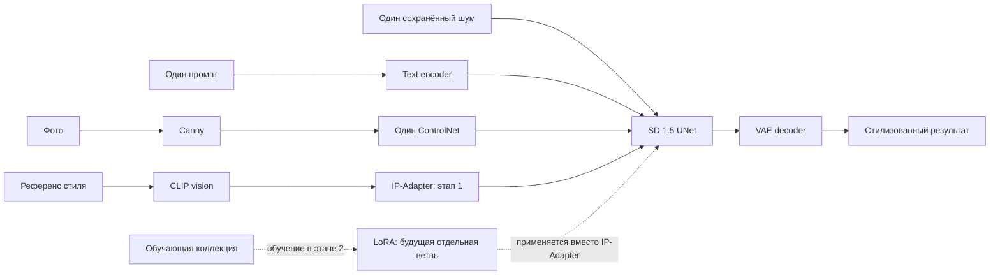

# Теоретическая база

## Stable Diffusion и начальный шум

[Latent Diffusion](https://arxiv.org/abs/2112.10752) переносит диффузионную модель из пикселей в компактное пространство VAE. Для SD 1.5 при 512 × 512 латент имеет четыре канала и пространственный размер 64 × 64. При обучении модель учится предсказывать добавленный к латенту шум; при генерации начинает с z_T и последовательно уменьшает шум.

CLIP text encoder формирует представление промпта; UNet использует его через cross-attention. Scheduler определяет уровни шума и численное обновление латентов. VAE decoder преобразует финальный латент в RGB. Classifier-free guidance усиливает различие между условным и безусловным предсказаниями; CFG 7.5 является исходной настройкой проекта, а не доказанным оптимумом.

В этом проекте используется text-to-image ControlNetPipeline, не img2img. Исходная фотография не кодируется VAE для начального состояния. Это принципиально для проверки вклада ControlNet: фото задаёт только пространственное условие Canny, его содержание также описывается настоящим COCO caption.

DDIM с eta = 0 не добавляет дополнительный случайный шум в обновления scheduler. Мы сохраняем фактический unscaled N(0,1) тензор до умножения пайплайном на init_noise_sigma. Один сохранённый тензор затем может быть применён в обеих сравниваемых ветвях. Одинаковый seed без фиксации устройства, формы, dtype и версии генератора для такого протокола недостаточен. [PyTorch не гарантирует полную воспроизводимость между платформами и версиями](https://docs.pytorch.org/docs/stable/notes/randomness.html).

## ControlNet и Canny

[ControlNet](https://arxiv.org/abs/2302.05543) добавляет пространственное управление к замороженной диффузионной модели. Обучаемая копия блоков обрабатывает условие; zero-initialized convolutions позволяют постепенно передавать дополнительные признаки, не разрушая исходную модель в начале обучения. В нашем проекте используется уже обученный ControlNet Canny для SD 1.5 — его веса не изменяются.

Canny строится после RGB, центрального crop и resize: RGB → grayscale → cv2.Canny(100, 200, apertureSize=3, L2gradient=False). Результат переводится в три одинаковых RGB-канала. Нижний/верхний пороги относятся к выделению границ, а ControlNet scale — к силе влияния уже построенной карты на генерацию. Это разные параметры.

Силуэты, границы предметов и перспективные линии помогают сохранять композицию. Canny не кодирует цвет, семантические классы и личность человека. Слабые границы могут исчезнуть, а текстура может создать слишком много линий. Поэтому сохранение карты не равнозначно сохранению содержания и дополнительно оценивается DINOv2.

## IP-Adapter

[IP-Adapter](https://arxiv.org/abs/2308.06721) дополняет текстовое условие изображением. CLIP vision encoder формирует признаки референса, проекция переводит их в токены изображения. В UNet добавляется отдельный image cross-attention, тогда как исходная текстовая ветвь сохраняется. В упрощённой записи вклад attention имеет вид Attn_text(Q,K_t,V_t) + λ · Attn_image(Q,K_i,V_i). Вес λ задаётся через set_ip_adapter_scale.

В baseline применён обычный ip-adapter_sd15.safetensors из models репозитория h94/IP-Adapter, с совместимым models/image_encoder (CLIPVisionModelWithProjection, hidden_size 1280, projection_dim 1024). Это не SDXL и не FaceID/Plus. Image encoder загружается явно с той же закреплённой revision; pipeline получает ip_adapter_image.

Референс содержит одновременно стиль и содержание. Рост λ способен усилить палитру, фактуру и мотивы картины, но также привнести её объекты или изменить композицию. Поэтому параметр 0.6 является начальной точкой, а не гарантией отделения стиля. [Официальная документация](https://huggingface.co/docs/diffusers/using-diffusers/ip_adapter) также описывает совместное использование адаптера с пространственным управлением.

## LoRA: только теория первого этапа

[LoRA](https://arxiv.org/abs/2106.09685) параметризует обновление замороженной матрицы через две малые матрицы. Для W ∈ R^(d_out × d_in):

W_eff = W + s · (α/r) · BA; B ∈ R^(d_out × r), A ∈ R^(r × d_in).

Число обучаемых параметров одного обновления: r(d_out + d_in). Ранг ограничивает пространство обновлений. Больше r — больше ёмкость и память адаптера; улучшение при этом не гарантировано, особенно на 70 картинах. Исходная статья посвящена языковым моделям; применение к diffusion UNet реализовано в [официальном примере Diffusers](https://github.com/huggingface/diffusers/blob/v0.35.2/examples/text_to_image/train_text_to_image_lora.py).

Training alpha α задаёт нормировку обновления при обучении. Inference scale s изменяет вклад уже обученного адаптера при генерации. Изменение alpha после обучения не воспроизводит обучение с другим alpha, поскольку отличается траектория оптимизации. Для будущего сравнения рангов необходимо закрепить alpha/r и target_modules.

Стилевая LoRA будет обучаться на изображениях одной художественной коллекции с captions; базовые UNet, VAE и text encoder замораживаются. ControlNet и IP-Adapter для этого не нужны. При сравнении IP-Adapter будет полностью заменён на LoRA; их одновременное применение отвечает другой исследовательской задаче.

## Постоянные и динамические коэффициенты — будущая гипотеза

Пусть k = 0…N−1 — индекс денойзинга, u = k/(N−1). Возможные схемы: constant s; increase 2s·u; decay 2s·(1−u). Среднее у трёх схем одинаково при N > 1. Если сравнивать 0 → s с constant s, одновременно меняются расписание и средняя сила; это смешение факторов необходимо исключить либо отдельно учитывать. Cosine schedule можно добавить при наличии бюджета.

Ранние и поздние этапы денойзинга влияют на разные аспекты изображения, поэтому момент применения стилевого условия потенциально меняет баланс структуры и фактуры. Предсказывать победителя без опыта некорректно. Будущая реализация должна задавать вес до первого UNet-вызова и учитывать семантику callback конца шага: новый вес относится к следующему шагу. В этапе 1 такого кода нет.

## Схема сравнения

Равенство условий генерации не означает равенства стилевой информации: LoRA видит коллекцию при обучении, IP-Adapter получает один выбранный референс. Это ограничение интерпретации сравнительных результатов.

## Источники

- [SD 1.5 и лицензия](https://huggingface.co/stable-diffusion-v1-5/stable-diffusion-v1-5).
- [ControlNet Canny SD 1.5](https://huggingface.co/lllyasviel/control_v11p_sd15_canny).
- [Веса и encoder IP-Adapter](https://huggingface.co/h94/IP-Adapter/tree/main/models).
- [DINOv2: статья](https://arxiv.org/abs/2304.07193), [выбранная конверсия модели](https://huggingface.co/facebook/dinov2-base).
- [Закреплённый исходный код Diffusers 0.35.2](https://github.com/huggingface/diffusers/tree/v0.35.2).
